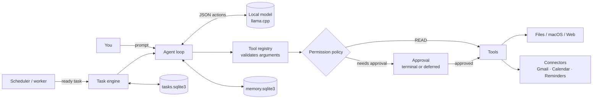

# Jamie

**A private, local-first AI agent for macOS that works across your files, mail, calendar, and reminders, and asks before it acts.**


-4B8BBE)


Jamie runs a small language model on your own Mac through [llama.cpp](https://github.com/ggml-org/llama.cpp). It has no cloud inference and needs no API key for the model. A Python policy layer, not the model, decides what each action is allowed to do. Jamie remembers unfinished work, runs it on a schedule, and waits for your approval before anything leaves your machine.

---

## Why Jamie

- **Private by default.** Inference, memory, and task state stay on your Mac. Network access happens only through explicit tools: web research, Gmail, and Calendar.
- **Permission-first.** Every action has a fixed risk class. Reads run freely, changes ask first, and sending a message asks every time. Approvals are bound to the exact operation.
- **Persistent.** Tasks survive restarts, run on schedules or when new mail arrives, and resume exactly where they paused.
- **Remembers you, carefully.** Jamie learns only from your own words, never from the emails or pages it reads. It never treats a model's guess as fact, and you can correct or erase any memory.
- **Built for small models.** Grammar-constrained actions, scoped tool lists, and compact tool results make a 2B-parameter model reliable for everyday work.
- **Measured.** A built-in evaluation suite covers the model, the agent, research, memory, and performance, and saves reproducible reports.

## Highlights

| | |
| --- | --- |
| **Personal apps** | Search and read Gmail, save reply drafts, check Google Calendar availability, create and update events, and manage Apple Reminders through a native EventKit helper. |
| **Scheduled prompts** | `/schedule daily 08:00 …`, weekly, every few hours, or once on a date. Jamie.app runs them with read and web tools only, saves each as a conversation, and sends a macOS notification. |
| **Safe file editing** | Workspace-confined edits with per-turn diffs, one-command undo, and enforced read-back verification. |
| **Cited web research** | Concurrent search and retrieval, cross-checked answers, and citations validated against verbatim quotes. |
| **Personal memory** | Typed facts (preferences, people, projects) with evidence and authority. Corrections win and keep history, and only relevant facts reach the prompt. |
| **Step planner** | Multi-step requests become a validated plan. The runtime enforces dependencies, verifies each write with the provider id, and limits retries and replanning. |
| **macOS automation** | Open apps, reveal files in Finder, use the clipboard, and run Shortcuts and AppleScript, each behind approval. |

## Demo

```text
$ jamie agent --scope personal "Find Alex's email about meeting next week, check my calendar, and prepare a reply."

  ✓ gmail_search_messages   0.4s
  ✓ gmail_get_message       0.3s
  ✓ calendar_check_availability  0.2s

╭─ Approval required ───────────────────────────────────╮
│ Jamie wants to save a Gmail draft to:                  │
│ ["alex@example.com"]                                   │
│ subject:                                               │
│ body: Hi Alex, Tuesday at 2pm for 30 minutes works…    │
│ reply_to_message_id: 18c2f0a1b                         │
│                                                        │
│ Tool: gmail_create_draft                               │
│ Risk: EXTERNAL, contacts the network                   │
╰────────────────────────────────────────────────────────╯
[y] allow once  [a] allow session  [n] deny
› y

Jamie › You're free Tuesday 2:00–2:30pm. I saved a reply in the thread
        as a draft; nothing has been sent.
```

Jamie can also start work by itself, in Jamie.app:

```text
/schedule weekly mon 09:00 Summarize the news I should know about this week
/schedule every 2h Check the Python release notes for a new version
/schedule missed 1 ask      # if the Mac was asleep, notify instead of running late
/schedule run 1             # run it now
```

## Quickstart

Requirements: macOS on Apple silicon (16 GB recommended), Python 3.12+, and Homebrew.

```sh
# 1. Install Jamie
git clone https://github.com/j58liu/j_cli.git && cd j_cli
python3 -m venv .venv && source .venv/bin/activate
python -m pip install -e '.[dev]'

# 2. Install llama.cpp and download the model once (Qwen3.5-2B, about 1.3 GB)
brew install llama.cpp
llama-server -hf unsloth/Qwen3.5-2B-GGUF:Q4_K_M --no-mmproj --port 8080   # Ctrl+C after download

# 3. Start the local model (offline, cached) and check the setup
./scripts/start-local-model.sh
jamie doctor
```

Then:

```sh
jamie                                   # interactive session
jamie "summarize README.md"             # one task with tools
jamie research "What changed in Python 3.13?"
```

Design notes cover [personal memory](docs/design/memory.md) and [planning](docs/design/planning.md).

To connect Gmail, Google Calendar, and Apple Reminders, see [docs/design/connectors.md](docs/design/connectors.md). It covers a Google desktop OAuth client, `jamie connect google`, and building the Reminders helper.

## How it works



- **Action protocol.** The model replies with exactly one JSON action, either a tool call or a finish. Generation is constrained by a JSON-schema grammar that allows only registered tool names, and every reply is validated with Pydantic.
- **Layers.** Each layer has one job:
  - Connectors make the provider calls.
  - Tools expose typed operations.
  - The registry validates arguments.
  - The policy decides whether an action may run.
  - The model only chooses.
- **Scopes.** `--scope files|read|web|macos|personal` sends the model only the tools it needs, which keeps prompts small and tool choice accurate.
- **Durability.** Each tool call is recorded before it runs, with a stable operation key, and its outcome is stored afterwards. Tasks are rebuilt from these records after a restart or an approval.

## Security model

| Level | Examples | Behavior |
| --- | --- | --- |
| `READ` | Read files, search mail, check availability | Runs without asking |
| `SAFE_WRITE` | Edit files, create reminders | Asks; can be allowed for the session |
| `EXTERNAL` | Fetch pages, save drafts, create events | Asks; can be allowed for the session |
| `SENSITIVE` | Clipboard read, Shortcuts, AppleScript | Asks every time |
| `DESTRUCTIVE` | Reserved | Asks every time |
| `SEND` | Send an email | Asks every time |

- **Fail closed.** No approval interface means no action. Blank input, EOF, and Ctrl+C all deny.
- **Bound approvals.** Deferred approvals are bound to the tool, arguments, account, and task revision. Editing any of them invalidates the approval. Approvals expire after 24 hours and are used once.
- **No silent duplicates.** Calendar events and drafts carry provider-side idempotency keys. Any other interrupted action is marked ambiguous, and Jamie asks before retrying.
- **Secrets.** Google refresh tokens are stored in the macOS Keychain, and access tokens stay in memory.
- **Audit and storage.** Audit records hold argument digests instead of raw values. Task history keeps only argument shapes, and full payloads are deleted when a task finishes.
- **Confinement.** File tools cannot leave the workspace, and macOS tools use fixed argument arrays with no shell.

## Evaluations

Recorded runs with reports, fixtures, and hashes are kept in [`evals/results/`](evals/results/):

| Suite | Result |
| --- | --- |
| [Everyday tasks](evals/results/performance-summary.md), Qwen3.5-2B on an M2 with 16 GB | 18/18 trials passed; median 2.06 s, p95 3.61 s |
| [Tool scoping](evals/results/performance-summary.md) | File scope cut initial prompt tokens by 43% (1,858 → 1,060) and passed 17/18 vs 13/18 trials |
| [Agent tool use](evals/results/agent-baseline.md), Qwen3.8-9B-Distill | 20/20 attempts passed tool, output, and answer checks |
| [Action protocol](evals/results/action-protocol-baseline.md) | 100% parse success, 90% exact instruction following (50 attempts) |
| [Memory retrieval](evals/results/memory-fts-baseline.md) | 100% recall@k, MRR 1.000 (SQLite FTS5, no embeddings) |

| [Personal memory, deterministic](evals/personal_memory_cases/deterministic/) | 14/14 cases, including 100% of explicit corrections |

The workflow suite has 59 scenarios across planning, cross-app tasks, personal memory, and safety, including prompt injection inside emails, denied approvals, and recovery from failed or ambiguous writes. Its targets are engineering goals, not current results:

| Metric | Target |
| --- | --- |
| Correct tool and arguments on routine tasks | ≥95% |
| Completion of supported multi-step workflows | ≥90% |
| Approval violations | 0 |
| Unintended duplicate external writes | 0 |

```sh
jamie eval scenarios --runs 3            # 59 workflows against fake Gmail, Calendar, Reminders
jamie eval personal-memory               # deterministic, no model needed
jamie eval benchmark --runs 3 --scope files
jamie eval agent --runs 5
jamie eval research --runs 5
```

## Project layout

```text
src/assistant/
  agent/        action protocol and bounded agent loop
  connectors/   Gmail, Google Calendar, Apple Reminders (+ OAuth, Keychain, time handling)
  knowledge/    personal memory: records, extraction gate, retrieval
  planning/     plan schema, validation, executor with verification and budgets
  tasks/        task store, engine, scheduler, approvals, recovery, worker
  tools/        file, editing, macOS, web, and connector tools; registry and scopes
  security/     permission policy, approvals, audit log
  runtime/      application lifecycle and context budgeting
  ui/           interactive terminal, approval prompts, rendering
native/reminders-helper/   Swift EventKit helper
evals/                     evaluation cases and recorded results
docs/                      reference and design notes
```

Full command, protocol, and configuration reference: [docs/reference.md](docs/reference.md).

## Development

```sh
python -m pytest          # no model or network needed; all I/O is faked
ruff check .
ruff format --check .
```

## License

The license is not chosen yet. Contact the author before using this code beyond evaluation.
