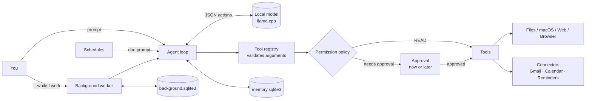

# Jamie

**A private, local-first AI agent for macOS that works across your files, mail, calendar, and reminders, and asks before it acts.**


-4B8BBE)


Jamie runs a small language model on your own Mac through [llama.cpp](https://github.com/ggml-org/llama.cpp). It has no cloud inference and needs no API key for the model. A Python policy layer, not the model, decides what each action is allowed to do. Jamie works in the background while you do other things, runs prompts on a schedule, and waits for your approval before anything leaves your machine.

---

## Why Jamie

- **Private by default.** Inference, memory, and task state stay on your Mac. Network access happens only through explicit tools: web research, Jamie's browser, Gmail, and Calendar.
- **Permission-first.** Every action has a fixed risk class. Reads run freely, changes ask first, and sending a message asks every time. Approvals are bound to the exact operation.
- **Persistent.** Background tasks and scheduled prompts are saved to disk. A task cut off by a restart is marked interrupted for you to retry, never silently run twice.
- **Remembers you, carefully.** Jamie learns only from your own words, never from the emails or pages it reads. The local model first checks whether a message tells Jamie something about you, so questions like "what's my name?" are never saved as facts. You can correct or erase any memory.
- **Built for small models.** Grammar-constrained actions, scoped tool lists, and compact tool results make a 4B-parameter model reliable for everyday work.
- **Measured.** A built-in evaluation suite covers the model, the agent, research, memory, and performance, and saves reproducible reports.

## Highlights

| | |
| --- | --- |
| **Just say it** | In Jamie.app there are no commands to learn. Each message is routed by the local model in a fraction of a second: answer directly, use only the tools it needs, work **in the background** ("…while I work"), or **schedule** it ("every weekday at 8, …"). |
| **Background work** | Hand Jamie several tasks and keep working. Up to two run at once; progress, results, and anything needing your OK appear in a tray above the message box, with a macOS notification. Ask "what are you working on?" or "stop the flight search" in plain words. |
| **Job applications** | "Apply to these jobs: <links>". Jamie fills each application (Greenhouse, Lever, Ashby, Workday, LinkedIn Easy Apply, Indeed, and ordinary forms) from your applicant profile and résumé, shows the final page as a screenshot, and submits when you approve, or by itself if you said so. It saves the confirmation page, never fills government IDs or bank details, and hands back questions only you can answer. |
| **Your whole Mac** | Spotlight search by name or content, recent files, and reading text, PDF, and Word files anywhere in your home folder. Keychains, SSH keys, browser profiles, Messages, and Mail are always off limits. |
| **Its own browser** | Jamie browses with a saved profile, so you log in to a site once and later tasks reuse it. Buttons that submit, send, pay, or delete always ask first. Jamie never types passwords. |
| **Fine-tuned for Jamie** | `training/train.sh` fine-tunes the 4B model on your Mac (MLX, about 2-3 hours) on Jamie's own tools and installs it. See [training/README.md](training/README.md). |
| **Personal apps** | Search and read Gmail, save reply drafts, check Google Calendar availability, create and update events, and manage Apple Reminders through a native EventKit helper. |
| **Scheduled prompts** | `/schedule daily 08:00 …`, weekly, every few hours, or once on a date. Jamie.app runs them with read and web tools only, saves each as a conversation, and sends a macOS notification. |
| **Safe file editing** | Workspace-confined edits with per-turn diffs, one-command undo, and enforced read-back verification. |
| **Cited web research** | Concurrent search and retrieval, cross-checked answers, and citations validated against verbatim quotes. |
| **Personal memory** | Typed facts (preferences, people, projects) with evidence and authority, learned in the background after each message. Corrections ("my name is actually Carl") win and keep history, and only relevant facts reach the prompt. |
| **Step planner** | Multi-step requests become a validated plan. The runtime enforces dependencies, verifies each write with the provider id, and limits retries and replanning. |
| **macOS automation** | Open apps, reveal files in Finder, use the clipboard, and run Shortcuts and AppleScript, each behind approval. |

## Demo

```text
$ jamie agent --scope personal "Find Alex's email about meeting next week, check my calendar, and prepare a reply."

  ✓ gmail_search_messages   0.4s
  ✓ gmail_get_message       0.3s
  ✓ calendar_check_availability  0.2s

╭─ Approval required ───────────────────────────────────╮
│ Jamie wants to save a Gmail draft to:                  │
│ ["alex@example.com"]                                   │
│ subject:                                               │
│ body: Hi Alex, Tuesday at 2pm for 30 minutes works…    │
│ reply_to_message_id: 18c2f0a1b                         │
│                                                        │
│ Tool: gmail_create_draft                               │
│ Risk: EXTERNAL, contacts the network                   │
╰────────────────────────────────────────────────────────╯
[y] allow once  [a] allow session  [n] deny
› y

Jamie › You're free Tuesday 2:00–2:30pm. I saved a reply in the thread
        as a draft; nothing has been sent.
```

Jamie can also start work by itself, in Jamie.app:

```text
/schedule weekly mon 09:00 Summarize the news I should know about this week
/schedule every 2h Check the Python release notes for a new version
/schedule missed 1 ask      # if the Mac was asleep, notify instead of running late
/schedule run 1             # run it now
```

## Quickstart

Requirements: macOS on Apple silicon (16 GB recommended), Python 3.12+, and Homebrew.

```sh
# 1. Install Jamie
git clone https://github.com/j58liu/j_cli.git && cd j_cli
python3 -m venv .venv && source .venv/bin/activate
python -m pip install -e '.[dev]'

# 2. Install llama.cpp and download the model once (Qwen3.5-4B, about 2.7 GB)
brew install llama.cpp
llama-server -hf unsloth/Qwen3.5-4B-GGUF:Q4_K_M --no-mmproj --port 8080   # Ctrl+C after download

# 3. Start the local model (offline, cached) and check the setup
./scripts/start-local-model.sh
jamie doctor

# 4. Optional: Jamie's browser uses Google Chrome when installed; otherwise run once
playwright install chromium
```

Then:

```sh
jamie                                   # interactive session
jamie "summarize README.md"             # one task with tools
jamie research "What changed in Python 3.13?"
```

In Jamie.app (`jamie gui`), just talk:

```text
What's on my calendar tomorrow?
Find the lease PDF and tell me when the rent goes up.
Research standing desks under $500 while I work.
Every weekday at 8:00, summarize my unread email.
Use my résumé to set up job applications.
Apply to these jobs: https://jobs.lever.co/acme/123 https://boards.greenhouse.io/globex/jobs/9
Open the browser so I can log in to LinkedIn.
What are you working on?
```

From a terminal, `jamie bg add "<task>"`, `jamie bg list`, and `jamie bg approvals` /
`approve <id>` work with the same background queue, and `jamie serve` runs it without
the window.

Design notes cover [personal memory](docs/design/memory.md) and [planning](docs/design/planning.md).

To connect Gmail, Google Calendar, and Apple Reminders, see [docs/design/connectors.md](docs/design/connectors.md). It covers a Google desktop OAuth client, `jamie connect google`, and building the Reminders helper.

## How it works



- **Action protocol.** The model replies with exactly one JSON action, either a tool call or a finish. Generation is constrained by a JSON-schema grammar that allows only registered tool names, and every reply is validated with Pydantic.
- **Layers.** Each layer has one job:
  - Connectors make the provider calls.
  - Tools expose typed operations.
  - The registry validates arguments.
  - The policy decides whether an action may run.
  - The model only chooses.
- **Scopes.** `--scope files|read|web|macos|personal|tasks|browser|jobs` sends the model only the tools it needs, which keeps prompts small and tool choice accurate. Jamie.app picks the scopes for each message by itself.
- **Durability.** Planned steps carry a stable operation key, so a retried calendar event or draft is not created twice. Background tasks and their pending approvals live in `background.sqlite3`.

## Security model

| Level | Examples | Behavior |
| --- | --- | --- |
| `READ` | Read files, search mail, check availability | Runs without asking |
| `SAFE_WRITE` | Edit files, create reminders | Asks; can be allowed for the session |
| `EXTERNAL` | Fetch pages, save drafts, create events | Asks; can be allowed for the session |
| `SENSITIVE` | Clipboard read, Shortcuts, AppleScript | Asks every time |
| `DESTRUCTIVE` | Reserved | Asks every time |
| `SEND` | Send an email, submit a form or job application | Asks every time |

- **Fail closed.** No approval interface means no action. Blank input, EOF, and Ctrl+C all deny.
- **Always asked.** Some writes ask every time, even when their level would allow a session-wide OK: Gmail drafts, calendar events, reminders, moving a file outside the workspace, and uploading a file in the browser.
- **Approvals for background work.** A background task waits for your answer from the app, a notification, or `jamie bg approve`. The approval is bound to the tool and its arguments, and an unanswered request expires after 24 hours and counts as "no".
- **No silent duplicates.** Calendar events and drafts carry provider-side idempotency keys. An interrupted action is marked ambiguous or interrupted, and Jamie asks before retrying.
- **Secrets.** Google refresh tokens are stored in the macOS Keychain, and access tokens stay in memory. Jamie never types passwords in its browser.
- **Audit.** Audit records hold argument digests instead of raw values.
- **Confinement.** Workspace file tools cannot leave the workspace. Tools for the rest of the Mac stay in your home folder and never touch keychains, SSH keys, browser profiles, Messages, or Mail. macOS tools use fixed argument arrays with no shell.

## Evaluations

Recorded runs with reports, fixtures, and hashes are kept in [`evals/results/`](evals/results/):

| Suite | Result |
| --- | --- |
| [Everyday tasks](evals/results/performance-summary.md), Qwen3.5-2B on an M2 with 16 GB | 18/18 trials passed; median 2.06 s, p95 3.61 s |
| [Tool scoping](evals/results/performance-summary.md) | File scope cut initial prompt tokens by 43% (1,858 → 1,060) and passed 17/18 vs 13/18 trials |
| [Agent tool use](evals/results/agent-baseline.md), Qwen3.8-9B-Distill | 20/20 attempts passed tool, output, and answer checks |
| [Action protocol](evals/results/action-protocol-baseline.md) | 100% parse success, 90% exact instruction following (50 attempts) |
| [Memory retrieval](evals/results/memory-fts-baseline.md) | 100% recall@k, MRR 1.000 (SQLite FTS5, no embeddings) |
| [Memory classifier](evals/memory_classification/cases.json), Qwen3.5-4B | 93% of 130 messages labelled correctly; at the 0.7 cutoff, 1 wrong save of 70 and 8 missed facts of 60; median 0.65 s |
| [Personal memory, deterministic](evals/personal_memory_cases/deterministic/) | 14/14 cases, including 100% of explicit corrections |

The workflow suite has 59 scenarios across planning, cross-app tasks, personal memory, and safety, including prompt injection inside emails, denied approvals, and recovery from failed or ambiguous writes. Its targets are engineering goals, not current results:

| Metric | Target |
| --- | --- |
| Correct tool and arguments on routine tasks | ≥95% |
| Completion of supported multi-step workflows | ≥90% |
| Approval violations | 0 |
| Unintended duplicate external writes | 0 |

```sh
jamie eval scenarios --runs 3            # 59 workflows against fake Gmail, Calendar, Reminders
jamie eval personal-memory               # deterministic, no model needed
jamie eval memory-classifier             # which messages Jamie learns from
jamie eval benchmark --runs 3 --scope files
jamie eval agent --runs 5
jamie eval research --runs 5
```

## Project layout

```text
src/assistant/
  agent/        action protocol and bounded agent loop
  connectors/   Gmail, Google Calendar, Apple Reminders (+ OAuth, Keychain, time handling)
  knowledge/    personal memory: records, extraction gate, retrieval
  planning/     plan schema, validation, executor with verification and budgets
  background/   background task queue, worker, and deferred approvals
  browser/      Jamie's own browser session and tools
  jobs/         applicant profile and job application filler
  training/     scenarios and dataset for fine-tuning on Jamie's tools
  tools/        file, Mac-wide file, editing, macOS, web, task, and connector tools; registry and scopes
  security/     permission policy, approvals, audit log
  runtime/      application lifecycle, routing dispatch, daemon, and context budgeting
  ui/           interactive terminal, Jamie.app, approval prompts, rendering
  routing.py    picks what to do and which tools to use for each message
  schedule.py   /schedule forms and next-run times
native/reminders-helper/   Swift EventKit helper
training/                  fine-tuning scripts (MLX LoRA)
evals/                     evaluation cases and recorded results
docs/                      reference and design notes
```

Full command, protocol, and configuration reference: [docs/reference.md](docs/reference.md).

## Development

```sh
python -m pytest          # no model or network needed; all I/O is faked
ruff check .
ruff format --check .
```

## License

The license is not chosen yet. Contact the author before using this code beyond evaluation.
