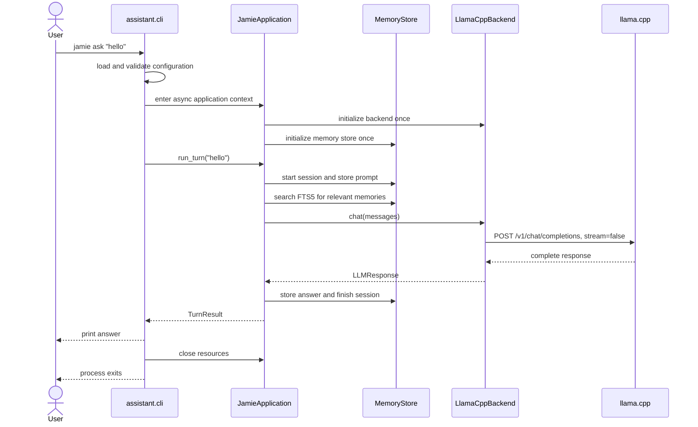
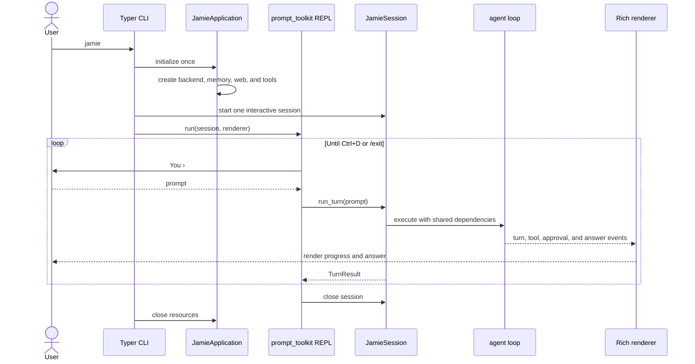

# Interactive terminal design

## Purpose and scope

Jamie currently provides short-lived Typer commands. This design adds a
persistent terminal session while keeping one application runtime for both
one-shot and interactive use. It keeps the existing `assistant` package and
builds on the current agent, tools, permission policy, memory store, and
llama.cpp transport. The initial terminal remains a normal scrolling terminal
using prompt_toolkit and Rich.

This document records the current architecture and the smallest useful path to
an interactive terminal. It does not change production behavior.

## Current architecture

| Area | Current responsibility |
| --- | --- |
| CLI entry point | `pyproject.toml` maps `jamie` to `assistant.cli:app`; `python -m assistant` calls the same Typer application. |
| Command routing | `assistant.cli.JamieGroup` routes an unknown first argument to `jamie agent`. With no arguments, Typer shows help. |
| Configuration | `assistant.config` validates `assistant.toml` without write side effects. |
| Application runtime | `assistant.runtime.JamieApplication` owns one backend and memory store for its async lifecycle and runs direct-chat turns. |
| Model transport | `assistant.llm.llamacpp.LlamaCppBackend` sends synchronous, non-streaming HTTP requests to `/v1/chat/completions`. |
| Direct chat | `jamie ask` starts a `JamieApplication`, runs one turn, prints the complete result, and closes the application. |
| Agent | `assistant.agent.loop.run_agent` owns one turn's model transcript, action parsing, tool observations, retries, repeated-failure checks, verification, and timeout. It contains no terminal printing. |
| Tools | `assistant.tools.registry.ToolRegistry` validates arguments, applies policy and approval, executes tools, records audit events, and tracks edit verification. |
| Permissions | `assistant.security.policy.PermissionPolicy` assigns fixed permission levels. `authorize` calls an injected `ApprovalProvider` for actions that require confirmation. |
| Terminal approval | `assistant.cli.TerminalApprovalProvider` prints the normalized request with Rich and asks with Typer. This is the main terminal-specific behavior currently mixed into the CLI module. |
| Memory | `assistant.memory.MemoryStore` persists sessions, messages, tool calls, sources, preferences, evaluation runs, and FTS5 memories. The application owns direct-chat persistence; CLI helpers still serve agent and research commands. |
| Research | `assistant.research.ResearchWorkflow` has its own bounded model workflow. The `research` command creates its backend and web client directly. |
| Evaluations | `assistant.eval_cli` and the evaluation modules construct their own isolated backends and fixtures. They should remain independent of interactive session state. |

The local model is loaded by the separately running llama.cpp server. Jamie does
not load model weights. One `JamieApplication` constructs one backend and
reuses it for every direct-chat turn until `close()`. Agent and research
commands still construct their own backends. Each call to `chat()` creates and
closes an HTTPX client, so HTTP connection reuse remains separate work.

Conversation state has two forms today:

- The agent loop keeps a local `list[Message]` for one call to `run_agent`.
  That list includes system instructions, the prompt, model actions, corrections,
  and tool observations. It is discarded when the call returns.
- SQLite stores completed high-level user and assistant messages. A later
  command searches FTS5 and places matching excerpts in the next request. It
  does not restore the complete model transcript.

There is no streaming interface. The request payload sets `stream` to `false`,
`LLMBackend.chat` returns one `LLMResponse`, and only completion token usage is
available. The current agent timeout stops waiting on a worker thread; it cannot
cancel an HTTP request or a tool function already in progress.

## Current `jamie ask` execution flow

`jamie ask` is direct chat rather than the tool-using agent loop. The CLI owns
argument validation and rendering while `JamieApplication` owns backend and
memory lifecycle.



The tool-using path is `jamie agent` or an unrecognized command name. It creates
`WebClient`, `ToolRegistry`, `TerminalApprovalProvider`, and
`RememberingTools`, then passes them with a new backend to `run_agent`.
`ToolRegistry.execute` is the only supported path from a model action to a tool.

## Shared runtime and session boundary

Keep `assistant.cli` as the entry point. The application lifecycle now provides
the first part of this structure; session and UI modules remain to be added:

```text
assistant/
├── runtime/
│   ├── application.py
│   └── session.py
├── agent/
│   ├── events.py
│   ├── loop.py
│   └── protocol.py
└── ui/
    ├── repl.py
    ├── renderer.py
    ├── commands.py
    ├── prompt.py
    ├── status.py
    └── approvals.py
```

`JamieApplication` is the current direct-chat composition root. It receives
validated configuration, creates one backend and memory store in `start()`,
runs multiple direct-chat turns with those objects, and closes backend resources
in `close()`. It is an async context manager and accepts factories for tests.
It should gain the web client, tool registry factory, and event sink when the
tool-enabled runtime moves behind the same boundary.

`JamieSession` should own session-scoped state: the SQLite session ID, active
workspace, high-level conversation history, current model transcript, and turn
cancellation state. Its primary operation should be one method such as:

```python
async def run_turn(self, prompt: str) -> TurnResult: ...
```

Both interfaces use that service:

- `jamie ask` creates an application, calls
  `run_turn` once, renders the result, and closes the application.
- `jamie` creates an application and one long-lived session, then calls
  `run_turn` for every prompt until exit.
- `jamie agent` should move onto the same service during the extraction so the
  existing tool-enabled one-shot behavior remains covered by the shared path.

The current `ask` command sends unconstrained chat while `agent` requires the
JSON action protocol. The runtime must represent this as an explicit session
capability rather than duplicating orchestration. The extraction should first
preserve `ask` options and direct-chat output. Interactive sessions use the
tool-enabled agent capability. A later product decision can change `ask`
semantics, but it is not required to build the terminal.

The session should retain the current interactive transcript between turns.
Older completed sessions continue to enter through FTS5. Retrieval should avoid
injecting exchanges already present in the active transcript. Context trimming
belongs in the session/runtime layer and must preserve the system instructions,
recent tool observations, and the latest user request.

## Event interface

`assistant.agent.events` defines frozen dataclasses and an `AgentEvent` union.
Both `JamieApplication.run_turn` and `run_agent` accept an optional synchronous
callback for each invocation:

```python
type EventSink = Callable[[AgentEvent], None]

result = await application.run_turn("hello", event_sink=renderer.handle)
```

The callback receives these event types:

| Event | Required data |
| --- | --- |
| `TurnStarted` | user prompt |
| `ToolStarted` | tool name and copied proposed arguments |
| `ToolFinished` | tool name, successful `ToolResult`, and elapsed seconds |
| `ToolFailed` | tool name, error text, and elapsed seconds |
| `ApprovalRequested` | copy of the existing normalized `ApprovalRequest` |
| `AssistantDelta` | user-visible answer fragment; reserved for future streaming |
| `AssistantFinished` | complete answer; optional model, finish reason, and completion usage |
| `TurnFailed` | error message |

The default callback does nothing. Return values and raised exceptions remain
available to library callers. `OneShotRenderer.handle` prints only the final
answer and its token-limit notice; CLI handlers retain error rendering and exit
codes. Each callback is scoped to one invocation. Invalid input is rejected
before `TurnStarted`; an accepted turn ends with `AssistantFinished` or
`TurnFailed`. Callbacks must be short, synchronous, and must not raise.

The agent worker queues events alongside its result. The calling thread drains
that queue in order, so rendering callbacks do not run in the worker. Events
arriving after a timeout are not delivered. The async direct-chat runtime
delivers its events on the event-loop thread. These are progress notifications,
not acknowledgements that a UI has rendered before execution proceeds.

Tool starts describe dispatch attempts, including ones later denied or rejected
by the registry. Successful results emit `ToolFinished`; failed results and
raised tool exceptions emit `ToolFailed`. A failed tool can be followed by
another model action; an exception that ends the turn also emits `TurnFailed`.

Approval remains synchronous and controlled by `PermissionPolicy` and
`ApprovalProvider`. The existing `authorize` function emits `ApprovalRequested`
before calling the provider. A context-local sink connects this nested event to
the active agent turn without replacing the provider. Events report requests;
only the trusted provider's boolean response determines approval.

The transport does not stream, so no `AssistantDelta` is emitted yet. Agent
answer events contain only an accepted finish message, never action JSON,
parse-retry text, or reasoning blocks. Direct-chat answers remove leading
`<think>...</think>` blocks and reject incomplete reasoning-only responses.
The transport already excludes the server's separate `reasoning_content`
field. The same visible answer is returned and stored in direct-chat memory.

## Proposed REPL lifecycle



The no-argument Typer path changes from help to the REPL. Named commands,
`--help`, and `--version` must retain their current routing. The existing
unknown-command-to-agent behavior also remains available.

prompt_toolkit owns line editing and history. Rich owns the banner, progress,
answers, separators, and status. The terminal keeps normal scrollback; no
alternate screen or Textual application is needed.

Local commands should be parsed before model invocation. `/help` and `/exit`
belong to the UI command router. Existing `/diff` and `/undo` must delegate to
the session's registry so audit recording, snapshots, and permission behavior
stay intact. Ctrl+D closes the session. Ctrl+C at the prompt clears the current
input; Ctrl+C during a turn requests cancellation and returns to the prompt
after the runtime confirms the turn has stopped.

Creating one application and session ensures the backend and supporting
resources are not reconstructed per prompt. The model itself remains resident
in llama.cpp, as it does today. The backend should be made closable and should
own a reusable HTTPX client so the interactive process also reuses connections.

## Modules to reuse

- `assistant.agent.loop`: retain action parsing, retry, step, repeated-action,
  timeout, observation, and edit-verification behavior.
- `assistant.agent.protocol`: retain the exact two-action protocol.
- `assistant.llm.base` and `assistant.llm.llamacpp`: retain backend boundaries;
  extend them deliberately for resource lifetime, usage, cancellation, or
  streaming.
- `assistant.tools.registry` and all registered tools: retain schema validation,
  dispatch, change tracking, and slash-command handling.
- `assistant.security`: retain central policy, approvals, and audit. UI adapters
  implement `ApprovalProvider`; they do not replace authorization.
- `assistant.memory`: retain SQLite persistence and FTS5 retrieval. Move the CLI
  session helpers into the runtime instead of copying them.
- `assistant.research`: retain the cited research workflow. Tool-driven research
  and the explicit `research` command can both be exposed through the runtime
  without merging their internal algorithms.
- `assistant.cli`: retain Typer command definitions and compatibility while
  reducing it to argument validation, dependency construction, and rendering.

## Interfaces to introduce

1. `JamieApplication`: long-lived dependency owner and factory for sessions.
2. `JamieSession`: shared turn lifecycle, conversation state, memory recording,
   and cancellation boundary.
3. Agent event models plus a no-op sink.
4. Event hooks around agent turns and tool execution. Hooks must observe the
   existing permission path rather than dispatch tools themselves.
5. One-shot and REPL renderers that consume the same events.
6. A prompt_toolkit loop and local command router.
7. A terminal approval provider in `assistant.ui.approvals`, moved out of the
   CLI module after the shared runtime exists.
8. Backend lifetime methods and a cancellation contract before claiming that an
   in-flight model request can be cancelled.

## Migration risks

- **Command routing:** changing the no-argument callback can accidentally turn
  `--help`, `--version`, or named commands into REPL input. Typer routing tests
  must lock down every existing command.
- **`ask` compatibility:** direct chat currently accepts temperature and token
  options and prints literal model text. Moving it to the runtime must preserve
  its request payload, errors, exit codes, and token-limit notice.
- **Conversation growth:** retaining tool transcripts across turns can exceed
  llama.cpp's configured context. The current API does not report prompt token
  counts or server context capacity, so the status line cannot claim exact
  context use until those values are available.
- **Memory duplication:** active-session messages and FTS5 recall can contain
  the same exchange. Retrieval needs an active-session exclusion or a clear
  deduplication rule.
- **Cancellation:** the current daemon-thread timeout abandons waiting while the
  synchronous HTTP call or tool may continue. Ctrl+C must not report
  cancellation and then allow a delayed side effect. Model requests need a
  closable/cancellable transport, and tool cancellation can only be promised at
  safe boundaries unless each tool supports it.
- **Event ordering:** callbacks run in order on the caller thread. Future
  interactive approvals must coordinate that event delivery with terminal input.
- **Approvals:** prompt_toolkit input and approval prompts cannot read the
  terminal concurrently. The REPL pauses normal input while the trusted
  approval provider owns the prompt.
- **Resource lifetime:** `WebClient`, HTTPX, memory sessions, and edit snapshots
  must close after EOF, `/exit`, exceptions, and interrupts.
- **Streaming:** adding a generator to the existing `chat` protocol can break
  fake backends and evaluations. Add a separate explicit streaming capability
  or adapter and retain `chat` for current callers.
- **Failure recovery:** a failed turn must emit `TurnFailed`, persist a failed
  turn state, and return control to the REPL without corrupting the next turn.

## Test strategy

Keep all current tests. Add focused tests as each interface appears:

- CLI tests verify that no arguments enter the REPL while `ask`, `agent`,
  `doctor`, `eval`, `--help`, `--version`, and unknown-prompt routing keep their
  current behavior.
- Application tests inject fake backend, memory, web, tools, events, and
  approvals. Two REPL turns must use the same application dependencies;
  one-shot mode must use the same turn service once.
- Session tests cover transcript retention, FTS recall without active-session
  duplication, success/failure persistence, cleanup, and a fresh context for a
  new session.
- Event tests assert ordered turn, tool, approval, answer, and failure events.
  They also assert that the agent and runtime do not print to the terminal.
- REPL tests use scripted prompt_toolkit input for multiple prompts, empty input,
  Ctrl+D, Ctrl+C at the prompt, errors followed by recovery, and clean shutdown.
- Command tests cover `/help`, `/exit`, `/diff`, and `/undo`, including the rule
  that local commands do not contact the model.
- Cancellation tests use blocking fake backends and tools to prove when the UI
  may safely return to the prompt and that cancelled work cannot execute a
  later side effect.
- Approval tests verify the exact normalized action shown to the user and prove
  that denial prevents execution through the existing policy path.
- Renderer tests use a recording console and stable event fixtures rather than
  snapshots of every terminal escape sequence.

Relevant existing coverage is in `test_cli.py`, `test_agent_cli.py`,
`test_agent_loop.py`, `test_llamacpp.py`, `test_security.py`, `test_tools.py`,
`test_editing_tools.py`, `test_memory_cli.py`, and the evaluation tests.

## Baseline

The full test suite was run on September 19, 2026 from a detached checkout of
commit `8aee59c` using Python 3.13.2:

```text
316 passed in 1.94s
```

`ruff check .`, `ruff format --check .`, `jamie --version`, and `jamie doctor`
also passed. The recorded version was `jamie 0.1.0`; diagnostics confirmed
Python 3.12 or newer and valid project configuration.
